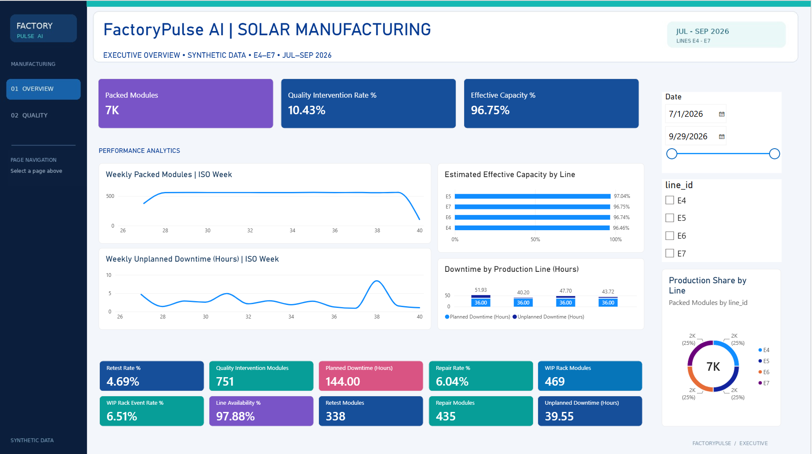
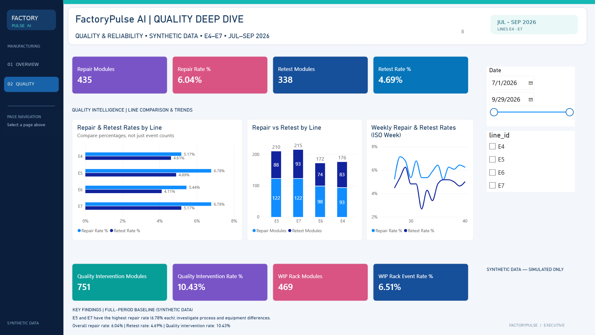

# FactoryPulse AI | Solar Manufacturing Analytics & Machine Learning

**Independent Portfolio Project | Python · Machine Learning · Power BI**

> **Data Disclaimer:** This project uses entirely synthetic, simulated manufacturing data. It does not contain actual factory production data, confidential information, proprietary process parameters, or operational measurements from any company.

## Project Overview

FactoryPulse AI is an independent analytics and machine-learning portfolio project designed to demonstrate how manufacturing data can be transformed into actionable insights.

The project simulates four solar-module manufacturing lines (E4–E7) and explores:

- Production throughput and manufacturing performance
- Equipment downtime and line availability
- Repair and retest rates
- Quality intervention trends
- Production-line comparisons
- Experimental next-day repair-rate prediction

It combines an interactive Power BI reporting project with a reproducible Python machine-learning workflow.

## Technologies Used

- **Programming:** Python
- **Data Analysis:** Pandas, NumPy
- **Machine Learning:** Scikit-learn, Random Forest Regression
- **Data Visualization:** Power BI, Matplotlib
- **Model Evaluation:** MAE, RMSE, R², chronological holdout, time-based backtesting
- **Version Control:** Git and GitHub

## Power BI Dashboard

The Power BI project includes two report pages.

### Executive Overview

Provides a high-level view of simulated manufacturing operations, including production volume, effective capacity, downtime, repair rates, retest rates, and line availability.

### Quality Deep Dive

Examines quality performance across simulated production lines, including repair and retest comparisons, weekly quality trends, and quality intervention metrics.

**Power BI project file:** `powerbi/FactoryPulse_Executive_Project.pbip`

### Dashboard Preview

#### Executive Overview



#### Quality Deep Dive



## Machine Learning Experiment

The machine-learning component investigates whether historical simulated manufacturing metrics can help predict the next day's repair rate.

The workflow includes:

1. Daily data aggregation
2. Historical feature engineering
3. Chronological training and holdout evaluation
4. Random Forest regression
5. Comparison against simple forecasting baselines
6. Expanding-window backtesting

**Training script:** `ml/train.py`

### Experimental Results

The recorded holdout evaluation produced the following results:

| Model | Mean Absolute Error |
|---|---|
| Random Forest Regression | 4.29 percentage points |
| Previous-Day Persistence Baseline | 5.15 percentage points |
| Historical Per-Line Mean Baseline | 3.79 percentage points |

Random Forest achieved an R² of **−0.324** and outperformed the historical-mean baseline in only **2 of 4** expanding-window evaluations.

These results indicate that the current model does not consistently outperform simpler approaches.

**The experiment is exploratory and does not demonstrate production-ready forecasting performance.**

## Reproduce the Experiment

Python 3.10 or newer is recommended.

```bash
cd ml
python -m pip install -r requirements.txt
python train.py
```

The script reads the synthetic input dataset from `ml/data/fact_module_quality.csv` and generates evaluation outputs in `ml/outputs/`.

Additional methodology and limitations are documented in `ml/README.md`.

## Open the Power BI Project

1. Install Power BI Desktop.
2. Open `powerbi/FactoryPulse_Executive_Project.pbip`.
3. If Power Query requests updated file paths, point the CSV data sources to the corresponding files under `powerbi/data/gold/`.
4. Refresh the data model.

The dashboard pages were reviewed visually in an earlier local test. Automated rendering validation is not included in this repository.

## Project Limitations

- All datasets are synthetic and intended for demonstration.
- Simulated patterns do not represent real manufacturing performance.
- The machine-learning model has not demonstrated reliable predictive accuracy.
- No model has been deployed in a production environment.
- The project is intended to demonstrate data preparation, analytical thinking, visualization, and model evaluation.

## Future Improvements

- Improve the realism of synthetic manufacturing signals
- Evaluate additional statistical and machine-learning models
- Expand time-based validation
- Improve reproducibility and automated testing
- Develop a predictive analytics dashboard page after validating the model

## Purpose

FactoryPulse AI demonstrates an end-to-end analytical workflow connecting manufacturing domain knowledge with Python, machine learning, and Power BI.

It is a technical portfolio project, not a commercial application or operational forecasting system.